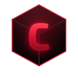

  

<h1 align="center">Crimson Mesh</h1>

A 3D model viewer for Linux that plays skeletons and animations, not just the mesh. 
Opens <a href="https://www.khronos.org/gltf/">glTF</a>, FBX, OBJ, STL and dozens more. 
Look around, then fly through it.

  
  
  

  <a href="https://github.com/Crimson-Org/crimson-mesh/releases/latest"><b>Download Here!</b></a>

## Why

A model sent by a friend or found online should open with a double click, without starting a 3D editor.\
Crimson Mesh shows it textured, lit and moving at once.

## Features

### The common formats

[Assimp](https://www.assimp.org/) reads glTF, FBX, OBJ, [Collada](https://www.khronos.org/collada/), STL, PLY, 3DS and many older formats.\
Embedded and external textures load, along with vertex colours.\
Dropping a model on the window opens it there, and each extra file gets a window of its own.

### Looking around

Drag with the left button to orbit, and with the middle button or Shift to pan.\
Drag with the right button to turn your head, and W, A, S and D fly with Q and E for down and up.\
Shift flies four times as fast, the wheel zooms and F frames the model again.\
Settings (Ctrl+,) change the mouse and fly speeds.

### Seeing how it is built

Wireframe (Z) draws each edge over the surface and Skeleton (J) shows the bones and joints.\
Files that hold only a rig show their skeleton by themselves.\
Grid (G), Textures (T) and Turntable (R) switch from the header bar.

### Animations

Animated models start playing, and the bar along the bottom pauses, scrubs and picks the animation.\
Space plays and pauses.

### Light and backdrop

Studio, Daylight, Headlight and Flat lighting cycle with L.\
Charcoal, Midnight, Studio Grey, Light and Black backgrounds cycle with B, and both choices are kept.

## Building

You need a [C compiler](https://gcc.gnu.org/), [make](https://www.gnu.org/software/make/), [pkg-config](https://www.freedesktop.org/wiki/Software/pkg-config/) and the development files for [GTK4](https://gtk.org) 4.14, [libadwaita](https://gnome.pages.gitlab.gnome.org/libadwaita/) 1.6, Assimp 5.1 and [libepoxy](https://github.com/anholt/libepoxy).\
On [openSUSE](https://www.opensuse.org/) these come from `sudo zypper install gcc make pkg-config gtk4-devel libadwaita-devel assimp-devel libepoxy-devel`.

Steps:
 1. Clone using `git clone --recurse-submodules https://github.com/Crimson-Org/crimson-mesh`
 2. Run `sh .crimson-build/install.sh`

`sh .crimson-build/uninstall.sh` removes it again.
